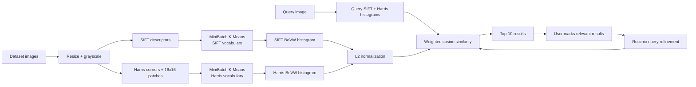
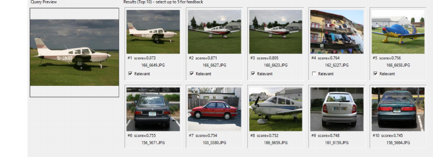
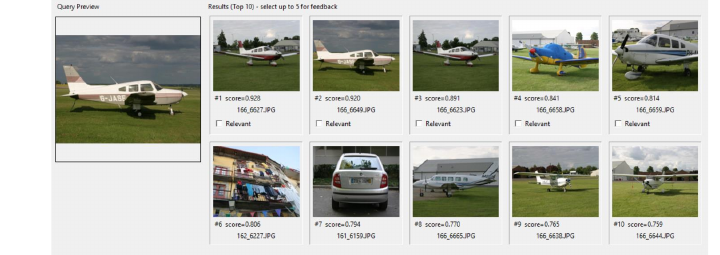

# Visual Search CBIR

A content-based image retrieval (CBIR) application built with classical computer-vision features. The system represents images with **SIFT** and **Harris-corner patch descriptors**, converts variable-length local features into dual **Bag-of-Visual-Words (BoVW)** histograms, ranks images with weighted **cosine similarity**, and supports interactive **Rocchio relevance feedback** through a Tkinter GUI.

## What the system does

A user selects a dataset, builds or loads an index, chooses a query image, and retrieves the **top 10 visually similar images**. The first five results can be marked as relevant; the query representation is then moved toward the selected examples and the search is repeated.



## Coursework configuration

The implementation follows the project configuration documented in the coursework report:

| Component | Configuration |
| --- | --- |
| Supported classes | `aeroplanes`, `benches_and_chairs`, `buildings`, `cars`, `doors`, `signs`, `windows` |
| Maximum image side | 512 px |
| SIFT vocabulary | 64 visual words |
| Harris vocabulary | 64 visual words |
| SIFT descriptors per image | up to 250 |
| Harris corners / descriptors | up to 300 |
| Harris patch | 16 x 16 normalized grayscale patch |
| Vocabulary sampling cap | 60,000 descriptors per feature family |
| Default similarity weights | SIFT 0.60, Harris 0.40 |
| Retrieval output | Top 10 |
| Relevance feedback | Select from top 5 |
| Rocchio feedback factor | 0.60 |

## Feature pipeline

### SIFT

SIFT provides 128-dimensional local descriptors designed to be robust to scale and rotation changes. In the project it forms the stronger default retrieval signal and receives a default weight of 0.60.

### Harris corner patches

Harris detects corner-rich structures such as windows, doors, frames, and signs. Around each selected corner, the system extracts a 16 x 16 grayscale patch, mean-centers it, and scales it by its standard deviation to form a lightweight local descriptor.

### Bag of Visual Words

Because each image produces a variable number of local descriptors, SIFT and Harris descriptors are clustered separately with MiniBatch K-Means. Each image is then represented by two fixed-length histograms of visual-word assignments.

### Similarity and feedback

The L2-normalized histograms are compared using cosine similarity:

`score = w_sift * sim_sift + w_harris * sim_harris`

After the user marks relevant examples, Rocchio feedback updates each query vector toward the centroid of the selected results:

`q' = (1 - lambda) * q + lambda * mean(relevant)`

## Qualitative evaluation

The coursework evaluation used representative queries from multiple classes, including cars, doors, and windows. The report assessed whether the highest-ranked results shared the query class or similar visual structure and whether relevance feedback reduced off-topic results. The documented observations were:

- SIFT generally provided the stronger retrieval signal because of its richer and more invariant local descriptor.
- Harris contributed useful structure for corner-heavy categories such as doors, windows, and signs.
- Relevance feedback moved the result set closer to the user's selected visual preference.

The repository also includes reusable `Precision@K` and `mAP@10` evaluation utilities for class-labeled datasets.

## GUI example

The coursework report documented interactive top-10 retrieval and relevance feedback. The examples below show one query before and after user feedback.

**Before relevance feedback**



**After relevance feedback**



## Portfolio refactor

The original coursework was implemented as a single Tkinter application. This repository keeps the same retrieval design while organizing it into reusable modules:

- dataset discovery and class scanning
- SIFT and Harris feature extraction
- visual-vocabulary training
- versioned index artifacts
- headless search CLI
- quantitative evaluation utilities
- Tkinter application
- automated tests, Ruff linting, and GitHub Actions CI

The original coursework source is preserved under `legacy/`.

## Installation

```bash
python -m venv .venv
```

Windows PowerShell:

```powershell
.\.venv\Scripts\Activate.ps1
python -m pip install --upgrade pip
python -m pip install -e ".[dev]"
```

Check the runtime:

```powershell
visual-search doctor
```

## Usage

### Inspect the dataset

```powershell
visual-search scan --dataset "C:\path\to\dataset"
```

### Build the index

```powershell
visual-search build-index `
    --dataset "C:\path\to\dataset" `
    --output artifacts\cbir_index.joblib
```

### Search from the command line

```powershell
visual-search search `
    --index artifacts\cbir_index.joblib `
    --dataset "C:\path\to\dataset" `
    --query "C:\path\to\query.jpg" `
    --top-k 10
```

### Launch the GUI

```powershell
visual-search app
```

The GUI provides dataset selection, index build/load, query preview, adjustable SIFT/Harris weights, top-10 retrieval, relevance marking, and Rocchio refinement.

### Quantitative evaluation

For a class-folder dataset, the evaluator can treat other images from the same class as relevant:

```powershell
visual-search evaluate `
    --index artifacts\cbir_index.joblib `
    --dataset "C:\path\to\dataset" `
    --max-queries 100
```

It reports `Precision@5`, `Precision@10`, and `mAP@10`.

## Repository structure

```text
visual-search-cbir/
├── src/visual_search_cbir/
│   ├── features/
│   ├── dataset.py
│   ├── vocabulary.py
│   ├── index.py
│   ├── retrieval.py
│   ├── feedback.py
│   ├── evaluation.py
│   ├── gui.py
│   └── cli.py
├── tests/
├── docs/
├── legacy/
├── .github/workflows/ci.yml
├── pyproject.toml
└── README.md
```

## Limitations and next steps

The current approach intentionally demonstrates classical visual retrieval rather than deep embeddings. BoVW discards spatial arrangement, the simple Harris patch descriptor is less invariant than SIFT, and index construction can be computationally expensive on large datasets. Natural extensions include larger vocabularies, stronger local descriptors, spatial verification, learned image embeddings, and systematic weight tuning.

## Tech stack

`Python` · `OpenCV` · `SIFT` · `Harris` · `MiniBatchKMeans` · `Bag of Visual Words` · `Cosine Similarity` · `Rocchio Relevance Feedback` · `Tkinter` · `scikit-learn`
